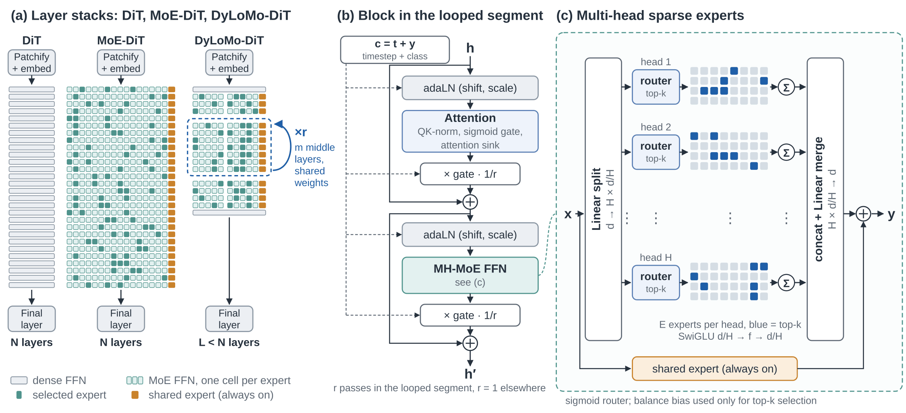
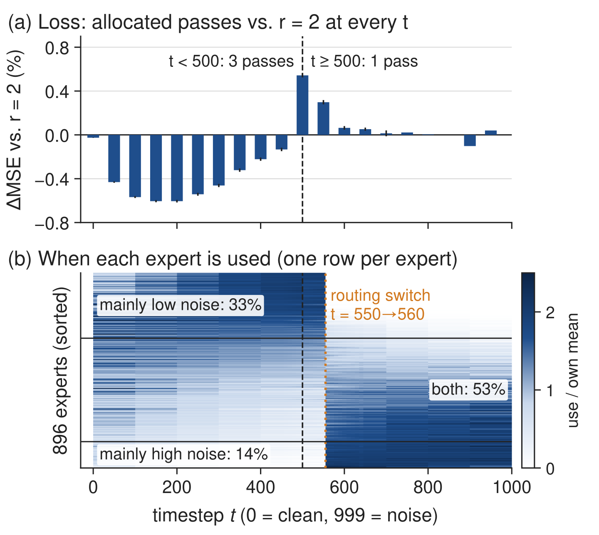
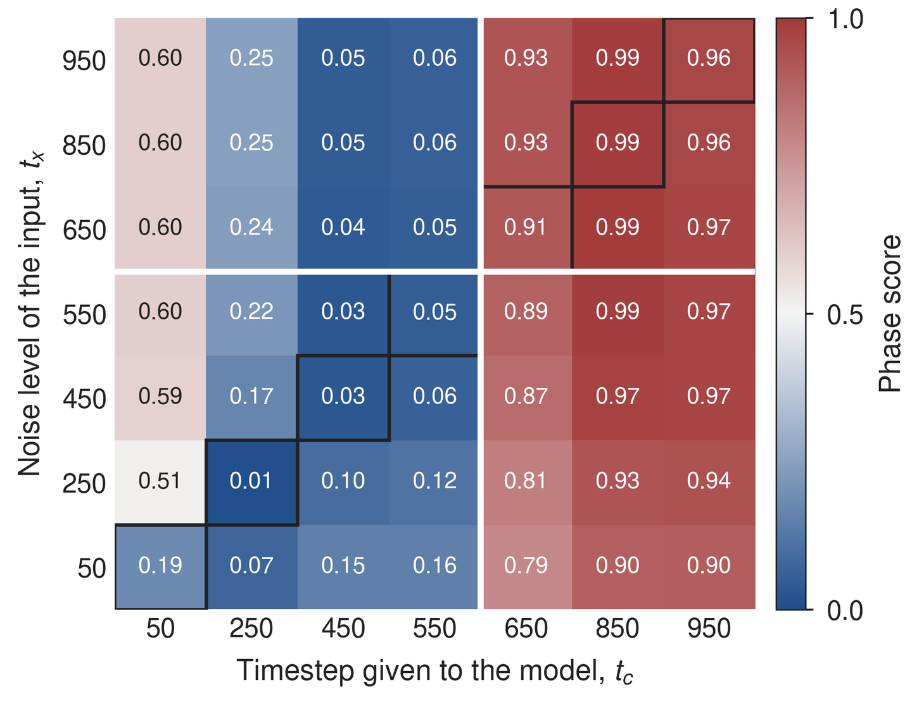
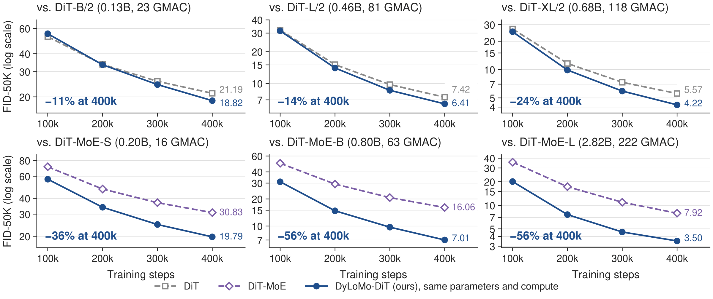
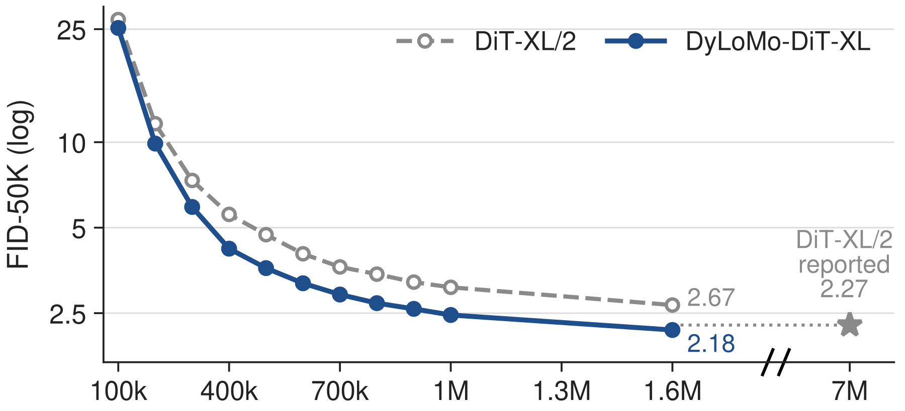
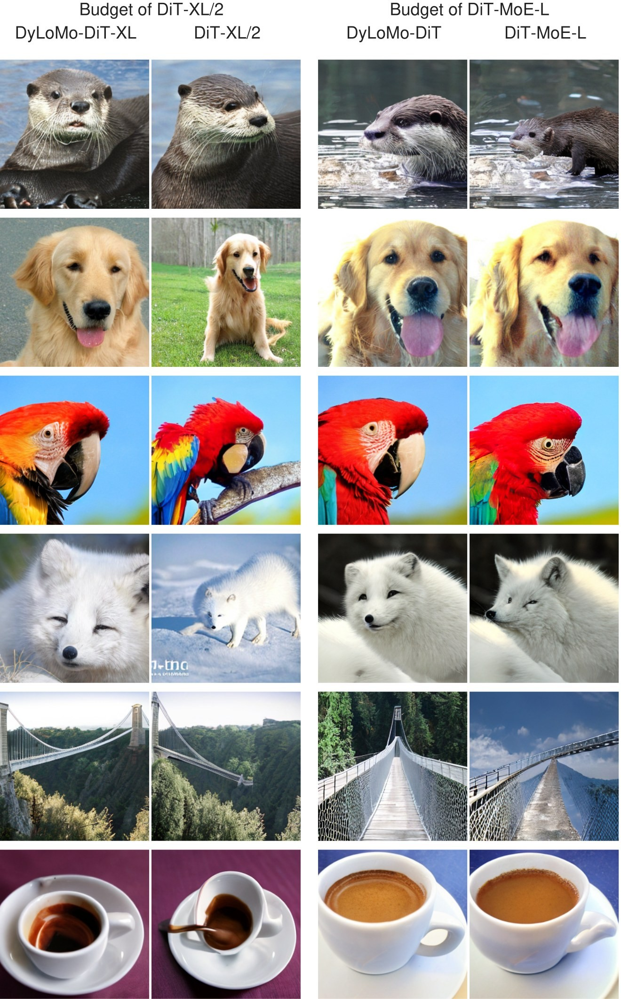

<div align="center">

# DyLoMo-DiT

### Dynamic Looped Mixture-of-Experts Diffusion Transformers

Lernie Li &nbsp;·&nbsp; Yuanliu Liu &nbsp;·&nbsp; Pengfei Xiong &nbsp;·&nbsp; Wei Zhang

<a href="https://arxiv.org/search/?query=DyLoMo-DiT&searchtype=all"></a>
<a href="https://oneboxcream.github.io/DyLoMo-DiT/"></a>
<a href="https://huggingface.co/OneCreamBox/DyLoMo-DiT-ImageNet256"></a>
<a href="https://huggingface.co/OneCreamBox/DyLoMo-DiT-T2I-Preview"></a>
<a href="LICENSE"></a>
<a href="https://creativecommons.org/licenses/by-nc/4.0/"></a>


<em>Text-to-image samples from DyLoMo-DiT (15.48B total parameters, 1.05B active per image token).</em>

</div>

**DyLoMo-DiT reuses parameters instead of adding them.** A weight-shared loop applies the middle layers several
times, sparse experts decide which parameters each token uses, and the number of passes changes with the noise
level. At the parameter and compute budget of DiT, it lowers FID on ImageNet 256×256 by **11–24%**; scaled up for
text-to-image generation, it scores higher on GenEval than FLUX.1 (**0.714 vs. 0.673**) with less than one tenth of
its active parameters.

## 🔥 News

* **2026-11-24** — Paper, code, ImageNet 256×256 weights and a text-to-image research preview
  are released.

## 📑 Release Status

- [x] Inference code: class-conditional and text-to-image
- [x] ImageNet 256×256 weights: DyLoMo-DiT-B / L / XL (400k steps) and DyLoMo-DiT-XL (1.6M steps)
- [x] Text-to-image weights: an intermediate checkpoint, released as a research preview
- [x] FID reproduction scripts and the compute accounting of the paper
- [ ] Training code for the ImageNet 256×256 experiments

## 📋 Contents

- [📖 Introduction](#-introduction)
- [✨ Highlights](#-highlights)
- [🧬 Architecture](#-architecture)
- [🔬 Mechanism](#-mechanism)
- [📊 Results](#-results)
- [🎨 Gallery](#-gallery)
- [🧱 Model Zoo](#-model-zoo)
- [🔧 Installation](#-installation)
- [🚀 Quick Start](#-quick-start)
- [📏 FID Reproduction](#-fid-reproduction)
- [🧮 Compute Accounting](#-compute-accounting)
- [🧠 Code Map](#-code-map)
- [🔢 Numerical Notes](#-numerical-notes)
- [🧪 Tests](#-tests)
- [📜 License](#-license)
- [📚 Citation](#-citation)

## 📖 Introduction

Diffusion Transformers (DiTs) scale model capacity by increasing both parameter count and computation.
Mixture-of-Experts (MoE) variants expand parameter capacity while keeping per-token computation roughly fixed, but
still require substantial parameter storage. **DyLoMo-DiT** (Dynamic Looped MoE DiT) reuses parameters rather than
adding them: a weight-shared loop repeatedly applies the middle layers, while sparse experts allocate parameter
capacity across tokens. This deepens the network without adding parameters, freeing the parameter budget for other
uses, such as more experts or more distinct layers. It also allocates compute dynamically, varying the number of
passes across noise levels.

This repository contains the model definitions (forward pass only), the ImageNet sampler and the 50k-sample script
of the FID protocol, a minimal text-to-image pipeline, and the tools for the compute accounting of the paper.

## ✨ Highlights

* 🧩 **Parameters per token.** Multi-head sparse experts: every token selects a few experts in each routing head, so
  the stored parameters can grow without growing the compute of a forward pass.
* 🔁 **Depth without parameters.** A weight-shared loop runs the middle layers several times with one set of weights.
* ⏱️ **Depth by noise level.** More passes at low noise, fewer at high noise; the schedule is part of the model and
  nothing has to be set at sampling time.
* 📉 **Better at matched budgets.** FID on ImageNet 256×256 is 11–24% lower than DiT and 36–56% lower than DiT-MoE at
  matched parameter and compute budgets.
* 🏃 **Keeps improving with training.** DyLoMo-DiT-XL reaches FID 2.18 at 1.6M steps, below the 2.27 reported for
  DiT-XL/2 after 7M steps.
* 🖼️ **Scales to text-to-image.** A 15.48B-parameter model with 1.05B active parameters per image token scores 0.714
  on GenEval, above FLUX.1 (0.673) with less than one tenth of its active parameters (1.05B vs. 12B).

## 🧬 Architecture

<p align="center">
  
</p>

**(a)** DiT, an MoE-DiT, and DyLoMo-DiT (column width sketches the stored parameters): the MoE-DiT keeps the *N*
layers of DiT and adds experts to each; DyLoMo-DiT has fewer physical layers (*L* < *N*), with *m* middle layers
sharing weights over *r* passes. **(b)** A looped layer. **(c)** Multi-head sparse experts: *H* heads, each router
selecting *k* of its *E* experts, plus a shared expert.

| | Component | What it does |
|---|---|---|
| 🧩 | **Multi-head sparse experts** | Except in the first and last layers, every feed-forward network splits its input into *H* heads. Each head's router selects *k* of its *E* experts for every token, and an always-on shared expert is added. At the XL tier, *H* = 4, *E* = 16 and *k* = 6. |
| 🔁 | **Weight-shared loop** | A middle segment of *m* layers is executed *r* times with one set of weights. Each sublayer writes to the residual stream with a factor of 1/*r*, and routing is recomputed in every pass, so a token may select different experts in different passes. |
| ⏱️ | **Passes by noise level** | The number of passes depends on the timestep: three for *t* < 500 and one for *t* ≥ 500, two on average over uniformly spaced sampling steps. |

## 🔬 Mechanism

The routers receive no explicit timestep input, and still learn to divide the experts by noise level.

<table>
<tr>
<td width="50%" align="center"></td>
<td width="50%" align="center"></td>
</tr>
<tr>
<td valign="top"><b>Extra passes help at low noise; experts split by noise level.</b> Top: against two passes at every timestep, allocating three passes below <i>t</i> = 500 and one above lowers the loss at low noise. Bottom: 33% of the experts are used mainly at low noise and 14% mainly at high noise; the routing switches within a narrow range of timesteps.</td>
<td valign="top"><b>The routing follows the timestep the model is given.</b> The input is noised to <i>t<sub>x</sub></i> while the timestep embedding receives <i>t<sub>c</sub></i>. The expert distribution flips with <i>t<sub>c</sub></i> (columns), not with the noise level of the input (rows): in the layers before the loop, it is closer to that of <i>t<sub>c</sub></i> in 95.5% of the cases across the switch.</td>
</tr>
</table>

* Allocating passes by noise level lowers FID by 4.2%, 4.7% and 3.4% in the B, L and XL tiers against two passes at
  every timestep; reversing the allocation worsens the B-tier FID by 33%.
* Within the low-noise or the high-noise range, the expert distribution of adjacent timesteps changes little
  (JS divergence of about 0.005 nats); between *t* = 550 and *t* = 650 it shifts sharply (0.30), and every layer
  switches.

## 📊 Results

### ImageNet 256×256 against DiT

400k training steps, EMA weights, 250-step DDPM, guidance scale 1.5, FID-50K. Each DiT row is the baseline trained
from scratch under the same protocol, at the same total parameters and forward compute. Numbers are means over
training seeds.

| Model | Total params (M) | Active params (M) | GMAC | FID ↓ | vs. DiT | sFID ↓ | IS ↑ | Prec. ↑ | Rec. ↑ |
|---|---|---|---|---|---|---|---|---|---|
| DiT-B/2 | 130.5 | 130.5 | 23.0 | 21.19 | — | 6.01 | 68.9 | 0.643 | 0.553 |
| **DyLoMo-DiT-B** | 128.5 | 75.8 | 23.1 | **18.82** | −11% | 5.56 | 70.9 | 0.684 | 0.551 |
| DiT-L/2 | 458.1 | 458.1 | 80.7 | 7.42 | — | 4.82 | 136.6 | 0.777 | 0.527 |
| **DyLoMo-DiT-L** | 451.3 | 278.3 | 80.1 | **6.41** | −14% | 4.50 | 140.5 | 0.799 | 0.526 |
| DiT-XL/2 | 675.1 | 675.1 | 118.6 | 5.57 | — | 4.67 | 158.2 | 0.801 | 0.526 |
| **DyLoMo-DiT-XL** | 686.6 | 411.3 | 117.8 | **4.22** | −24% | 4.30 | 174.4 | 0.824 | 0.524 |

<p align="center">
  
</p>

<p align="center"><em>FID versus training steps: DiT (top; B, L, XL tiers) and DiT-MoE (bottom; S, B, L tiers) against the DyLoMo-DiT with the same parameters and forward compute. Percentages give the relative FID reduction at 400k steps.</em></p>

### ImageNet 256×256 against DiT-MoE

Each pair is compared at the budget of the DiT-MoE tier, with DiT-MoE implemented from its public code and trained
under the same protocol.

| Model | Total params (M) | Active params (M) | GMAC | FID ↓ | vs. DiT-MoE | sFID ↓ | IS ↑ |
|---|---|---|---|---|---|---|---|
| DiT-MoE-S | 199.3 | 71.9 | 16.0 | 30.83 | — | 8.02 | 48.5 |
| **DyLoMo-DiT** (budget of DiT-MoE-S) | 199.6 | 56.9 | 16.1 | **19.79** | −36% | 5.90 | 68.5 |
| DiT-MoE-B | 795.9 | 286.3 | 62.9 | 16.06 | — | 5.90 | 86.9 |
| **DyLoMo-DiT** (budget of DiT-MoE-B) | 796.2 | 229.0 | 62.9 | **7.01** | −56% | 4.57 | 135.0 |
| DiT-MoE-L | 2824.0 | 1012.0 | 222.5 | 7.92 | — | 4.94 | 130.4 |
| **DyLoMo-DiT** (budget of DiT-MoE-L) | 2821.8 | 712.0 | 222.5 | **3.50** | −56% | 4.22 | 198.0 |

### Longer training

<p align="center">
  
</p>

The advantage persists with longer training: at 1M steps, DyLoMo-DiT-XL reaches an FID of 2.46 versus 3.08 for
DiT-XL/2; at 1.6M steps, it reaches **2.18**, below the 2.27 reported for DiT-XL/2 after 7M steps.

### Text-to-image

GenEval at the native resolution of each model; all models are evaluated with the same pipeline. GMAC counts one
forward pass of the denoiser.

| Model | Parameters (B) | Native resolution | GMAC | GenEval ↑ |
|---|---|---|---|---|
| **DyLoMo-DiT** | 15.48 total / 1.05 active | 1024² | 8,333 | **0.714** |
| FLUX.1-schnell | 12 | 1024² | 34,733 | 0.673 |
| FLUX.1-dev | 12 | 1024² | 37,192 | 0.671 |
| Sana-1.6B | 1.6 | 1024² | 1,483 | 0.632 |
| SDXL | 2.6 | 1024² | 3,381 | 0.551 |
| PixArt-α | 0.6 | 512² | 618 | 0.483 |

## 🎨 Gallery

### Text-to-image

<p align="center">
  
</p>

<p align="center"><em>Selected samples from the released text-to-image checkpoint; the prompts are listed in the paper.</em></p>

### ImageNet 256×256

<p align="center">
  
</p>

<p align="center"><em>Class-conditional samples (400k steps, guidance scale 4.0); rows: otter, golden retriever, macaw, arctic fox, suspension bridge, espresso. Left: at the compute of DiT-XL/2; right: at the budget of DiT-MoE-L. Each pair shares the class label and noise.</em></p>

## 🧱 Model Zoo

### Class-conditional, ImageNet 256×256 &nbsp; [🤗 weights](https://huggingface.co/OneCreamBox/DyLoMo-DiT-ImageNet256)

All models: 400k training steps unless noted, EMA weights, 250-step DDPM, classifier-free guidance 1.5, FID-50K with
the ADM evaluator.

| Model | Layers (looped) | Experts: heads x experts (selected) | Passes | Params total / active (M) | GMAC | FID |
|---|---|---|---|---|---|---|
| DyLoMo-DiT-B | 12 (6) | 2 x 17 (6) | 3 for t < 500, 1 for t >= 500 | 128.5 / 75.8 | 23.1 | 19.16 |
| DyLoMo-DiT-L | 12 (6) | 4 x 17 (6) | 3 for t < 500, 1 for t >= 500 | 451.3 / 278.3 | 80.1 | 6.25 |
| DyLoMo-DiT-XL | 16 (7) | 4 x 16 (6) | 3 for t < 500, 1 for t >= 500 | 686.6 / 411.3 | 117.8 | 4.34 |
| DyLoMo-DiT-XL, 1.6M steps | 16 (7) | 4 x 16 (6) | 3 for t < 500, 1 for t >= 500 | 686.6 / 411.3 | 117.8 | 2.18 |

For reference, the DiT baselines trained under the same protocol reach FID 21.19 (DiT-B/2), 7.42 (DiT-L/2) and
5.57 (DiT-XL/2) at 400k steps. GMAC is 10^9 multiply-accumulates of one forward pass, averaged over the 250 sampling
steps (see [Compute accounting](#-compute-accounting)).

**All released ImageNet checkpoints use training seed 42.** The FIDs above describe those individual weights.
Table 2 of the paper reports means over two training seeds: B 18.82, L 6.41 and XL 4.22.
The 1.6M-step model continues the seed-42 XL run. The released checkpoints' full metrics use EMA weights,
250-step DDPM, guidance scale 1.5 and 50,000 generated images:

| Released checkpoint | Training seed | FID ↓ | sFID ↓ | IS ↑ | Precision ↑ | Recall ↑ |
|---|---|---|---|---|---|---|
| DyLoMo-DiT-B (400k) | 42 | 19.16 | 5.56 | 70.2 | 0.68 | 0.55 |
| DyLoMo-DiT-L (400k) | 42 | 6.25 | 4.46 | 142.0 | 0.80 | 0.53 |
| DyLoMo-DiT-XL (400k) | 42 | 4.34 | 4.30 | 172.4 | 0.82 | 0.53 |
| DyLoMo-DiT-XL (1.6M) | 42 | 2.18 | 4.28 | 253.0 | 0.83 | 0.58 |

### Text-to-image &nbsp; [🤗 weights](https://huggingface.co/OneCreamBox/DyLoMo-DiT-T2I-Preview)

> **The text-to-image weights are an intermediate checkpoint, not a final model.** They are released to make the
> text-to-image result of the paper reproducible.

| Model | Params total / active per image token | Looped layers | Experts | GenEval (1024x1024) |
|---|---|---|---|---|
| DyLoMo-DiT text-to-image | 15.48B / 1.05B | 32 layers, middle 16 run twice | 4 x 128 (6) | 0.714 |

Text encoder: Qwen2.5-VL-7B (frozen); VAE: Wan2.2 VAE (48 channels, 16x downsampling); training objective: rectified
flow; sampling: 50 Euler steps, shift 1.6, APG with guidance scale 5.

## 🔧 Installation

```bash
git clone https://github.com/OneBoxCream/DyLoMo-DiT.git && cd DyLoMo-DiT
pip install -r requirements.txt
```

`requirements.txt` fixes the versions the code was tested with: PyTorch 2.5.1 to 2.11.0, diffusers 0.38.0,
transformers 4.57.1, safetensors 0.8.0, numpy 2.1.0 and pillow 12.1.1, on Python 3.12 (the class-conditional part
also on Python 3.10). Other combinations are not covered: PyTorch 2.4 cannot import this diffusers release, and newer
diffusers and transformers releases need a newer PyTorch. `requirements.lock.txt` lists the complete tested
environment, including indirect dependencies.

Check an installation with

```bash
python tools/check_install.py          # package versions, model code, sd-vae-ft-ema loading and decoding
python tools/check_install.py --t2i    # also the Wan2.2 VAE and the Qwen2.5-VL text encoder (large downloads)
```

The routed experts use `torch._grouped_mm` when the installed PyTorch provides it and fall back to a per-expert loop
otherwise; both give the same result.

Download the weights from the Hugging Face Hub:

```bash
# one ImageNet model folder (config.json + model.safetensors); also DyLoMo-DiT-B, DyLoMo-DiT-L, DyLoMo-DiT-XL-1.6M
huggingface-cli download OneCreamBox/DyLoMo-DiT-ImageNet256 --include "DyLoMo-DiT-XL/*" --local-dir checkpoints

# the text-to-image research preview (config.json, model.safetensors.index.json and all shards, about 32 GB)
huggingface-cli download OneCreamBox/DyLoMo-DiT-T2I-Preview --local-dir checkpoints/dylomo-dit-t2i
```

`dylomo.load_model()` reads both formats and preserves the stored expert dtype by default.

## 🚀 Quick Start

### Class-conditional sampling

```bash
python sample.py --model checkpoints/DyLoMo-DiT-XL --classes 360 207 88 279 839 967 --cfg-scale 4.0 --output sample.png
```

In Python:

```python
import torch, dylomo
from dylomo.diffusion import sample_class_conditional
from dylomo.vae import load_sd_vae, decode_sd_latents

model = dylomo.load_model("checkpoints/DyLoMo-DiT-XL", device="cuda")
vae = load_sd_vae(device="cuda")
latents, labels = sample_class_conditional(model, ids=range(4), labels=[360, 207, 88, 279], cfg_scale=4.0)
images = decode_sd_latents(vae, latents)        # uint8, [4, 256, 256, 3]
```

The number of passes through the looped segment is part of the model: `model(x, t, y)` reads it from the timestep
through the pass schedule in `config.json` (three passes for `t < 500`, one for `t >= 500`, i.e. two on average over
the sampling steps). Nothing has to be set at sampling time, and the released weights should not be run under a
different schedule.

### Text-to-image sampling

```bash
python t2i_sample.py --model checkpoints/dylomo-dit-t2i \
    --prompt "a red fox sitting in fresh snow, golden hour" --height 1024 --width 1024 --seed 0 1 --output outputs/
```

```python
from dylomo.pipeline_t2i import DyLoMoT2IPipeline

pipeline = DyLoMoT2IPipeline.from_pretrained("checkpoints/dylomo-dit-t2i", device="cuda")
image = pipeline("a red fox sitting in fresh snow, golden hour", height=1024, width=1024, seeds=[0])[0]
```

* The text encoder ([Qwen/Qwen2.5-VL-7B-Instruct](https://huggingface.co/Qwen/Qwen2.5-VL-7B-Instruct), language model
  only) and the VAE ([Wan2.2 VAE](https://huggingface.co/Wan-AI/Wan2.2-TI2V-5B-Diffusers), `vae` sub-folder) are
  downloaded from the Hugging Face Hub; `--text-encoder` / `--vae` accept local paths.
* Defaults are the settings behind the GenEval number: 50 Euler steps, shift 1.6, APG with guidance scale 5,
  momentum -0.5 and eta 0.15, the empty text as unconditional branch, no negative prompt, prompts not rewritten.
  The gallery of the paper additionally uses a larger shift at high resolution (3.88 at 1024x1024, 4.87 at
  1808x1024 and 1024x1808); pass it with `--shift`.
* Height and width must be multiples of 16. The checkpoint comes from the training stage with short side 1024.
* The evaluation of the paper used fp32 weights under bf16 autocast. The released safetensors store routed-expert
  parameters in bf16 and all remaining parameters in fp32 (about 32 GB of weights, split into shards; this is not a
  peak-memory estimate). Loading preserves that mixed storage, and sampling uses bf16 autocast. Random-weight
  checks on a reduced configuration give bit-identical outputs to all-fp32 files under bf16 autocast on CPU and
  CUDA, using deterministic algorithms. `--expert-dtype fp32` widens the stored expert values; it cannot recover
  precision discarded when the files were saved.
* The GenEval number of the paper follows the official protocol: 553 prompts with 4 images each (2,212 images) at
  1024x1024, scored with the official implementation. `--seed` seeds a standard PyTorch generator for the initial
  noise; it does not reproduce the individual images of that evaluation.
* Every token only uses 6 of the 128 experts of each routing head, so the compute of a forward pass corresponds to the
  1.05B active parameters, not to the 15.48B stored ones.

This is a research checkpoint. It can produce inaccurate, biased or otherwise objectionable images; it has no safety
filter and should not be deployed without one.

## 📏 FID Reproduction

Protocol of the paper: EMA weights, 250-step DDPM with the learned variance, classifier-free guidance scale 1.5
applied to the first three latent channels (as in DiT), fp32, `sd-vae-ft-ema` decoder, 50,000 samples with uniformly
drawn class labels, FID / sFID / IS / precision / recall computed with the TensorFlow evaluator of
[openai/guided-diffusion](https://github.com/openai/guided-diffusion/tree/main/evaluations) against its ImageNet 256x256
reference batch.

1. Generate 50,000 images (one GPU, or `torchrun` for several):

   ```bash
   python sample_ddp.py --model checkpoints/DyLoMo-DiT-XL --output runs/xl
   torchrun --nproc_per_node=8 sample_ddp.py --model checkpoints/DyLoMo-DiT-XL --output runs/xl
   ```

   This writes `runs/xl/samples.npz` (`arr_0`: `[50000, 256, 256, 3]` uint8). The noise and the label of every image
   depend only on its sample ID, so the image set does not depend on the number of GPUs (up to floating-point
   rounding). Interrupted runs resume with the same command. The settings of a run, the SHA-256 of the weight files
   and a digest of the VAE weights are recorded in `runs/xl/sampling.json`; a run with other weights, another VAE or
   other settings refuses to reuse the directory, so use one output directory per model and setting.

2. Evaluate with the ADM evaluator (a separate TensorFlow environment is the easiest way):

   ```bash
   git clone https://github.com/openai/guided-diffusion
   pip install -r guided-diffusion/evaluations/requirements.txt
   wget https://openaipublic.blob.core.windows.net/diffusion/jul-2021/ref_batches/imagenet/256/VIRTUAL_imagenet256_labeled.npz
   python guided-diffusion/evaluations/evaluator.py VIRTUAL_imagenet256_labeled.npz runs/xl/samples.npz
   ```

`--cfg-scale 1.0` samples without guidance. `--precision bf16` samples under bf16 autocast, which is not the
evaluation protocol.
On CUDA, TF32 is enabled for matrix products by default (`torch.backends.cuda.matmul.allow_tf32`), as in the
evaluation of the paper and in the sampling scripts of DiT. `--no-tf32` turns it off for matrix products only; the
cuDNN setting used by the convolutions of the VAE decoder is left at the PyTorch default.

## 🧮 Compute Accounting

`tools/count_gmac.py` recomputes the GMAC columns of the paper: multiply-accumulates of one denoiser forward pass,
measured on the instantiated model (matrix products and expert products, including the router scoring, counted by
PyTorch's flop counter; attention products counted from the shapes of the attention calls).

```bash
python tools/count_gmac.py --paper --skip-t2i        # B / L / XL: 23.1, 80.1, 117.8 GMAC
python tools/count_gmac.py --config configs/dylomo_dit_t2i.json --height 1024 --width 1024 --text-tokens 13 --device cuda
                                                     # text-to-image at 1024x1024: 8,333 GMAC
```

The count does not depend on the weight values, so no checkpoint is needed. The script checks itself: it stops with
an error instead of printing a number if no attention product was counted, or if a released configuration does not
reproduce the value of the paper.

## 🧠 Code Map

```
x_t --patchify--> tokens --[ front layers | looped middle layers x r | back layers ]--> noise (+ variance)
                                              shared weights, residual factor 1/r
```

* **Multi-head sparse experts** (`dylomo/moe.py`). Except in the first and the last layer, the feed-forward network
  splits its input into `H` heads; each head has its own router and `E` experts and selects `k` of them per token
  (sigmoid scores, top-k after adding a routing bias, weights L1-normalised over the selected experts), plus one
  always-on shared expert. The routing bias is a buffer (`*.core.expert_bias`) that is loaded with the weights and
  is constant at inference time; the released files hold its value at the end of training, which is the one the
  evaluation used.
* **Weight-shared loop** (`dylomo/loop.py`). The middle `loop_span` layers are executed `r` times with the same
  weights; inside the loop every sub-layer writes to the residual with factor `1/r`. Routing is recomputed in every
  pass.
* **Passes by noise level.** `r` depends on the timestep through `pass_schedule` in the config:
  `{"thresholds": [500], "passes": [3, 1]}` means three passes for `t < 500` and one for `t >= 500`.
* **Class-conditional models** (`dylomo/models/class_cond.py`): adaLN-Zero conditioning on timestep + class, RMSNorm,
  rotary positions, attention with QK normalisation, a per-head output gate and an attention sink; the output layer
  predicts noise and variance (DDPM objective of DiT).
* **Text-to-image model** (`dylomo/models/t2i.py`): text and image tokens in one sequence, the diffusion time written
  into the first 64 input channels instead of adaLN, a 4-stream residual, separate weights for image and text tokens
  in the first and last layer, rectified-flow velocity prediction.

Configs of the released models are in `configs/`; parameter names and shapes are documented in
[docs/PARAMETERS.md](docs/PARAMETERS.md).

## 🔢 Numerical Notes

* **Equivalence with the training implementation.** The forward passes in this repository were checked bit for bit
  (fp32, TF32 off, deterministic algorithms) against the implementation the weights were trained with: with random
  weights for the B / L / XL configurations and the text-to-image architecture, on CPU and on CUDA, and with the
  released DyLoMo-DiT-XL (400k) weights on CUDA, including the final latents of the 250-step DDPM sampler.
  `tests/test_reference_equivalence.py` is that check (it needs the original code and is skipped otherwise);
  `tests/test_golden.py` compares against outputs recorded from the original implementation and runs anywhere.
* **Mixed-precision storage.** The text-to-image files store routed-expert parameters in bf16. Under bf16 autocast,
  the setting of the evaluation, the outputs of the released files are bit-identical to those of the original fp32
  weights in the original implementation, including a short Euler + APG sampling run.
* **Non-determinism on CUDA.** The scatter-add that sums the selected experts of a token is not deterministic, so two
  runs of the same model differ in the last bits. In our check (DyLoMo-DiT-B with random weights), the largest
  difference between two forward passes was about 2e-5 at an output magnitude of about 20.
  `sample_ddp.py --deterministic` switches PyTorch to deterministic algorithms, with which repeated runs on the same
  GPU gave bit-identical results.
* **Metrics.** FID and GenEval of the released checkpoints have not been re-measured with this repository, and the
  effect of the non-determinism above, of `--deterministic` and of `--no-tf32` on the metrics has not been measured.
* The text-to-image evaluation in the paper was run with a multi-GPU implementation of the same computation (fp32
  weights, bf16 autocast); this repository provides the single-GPU reference path.
* Text features are computed with every prompt padded to the full length of 1,000 tokens, as during training
  (`QwenTextEncoder(pad_to_max_length=False)` skips the padding; its features differ by bf16 rounding).

## 🧪 Tests

```bash
pip install pytest
pytest tests
python tools/check_install.py
```

## 📜 License

The code is released under **Apache-2.0**; see [LICENSE](LICENSE). Third-party attributions are in [NOTICE](NOTICE) and
[LICENSES/](LICENSES); the licenses of the Python packages the code depends on are listed in
[THIRD_PARTY_LICENSES.md](THIRD_PARTY_LICENSES.md).
Both the ImageNet and text-to-image weights are released under
[Creative Commons Attribution-NonCommercial 4.0 International (CC BY-NC 4.0)](https://creativecommons.org/licenses/by-nc/4.0/). The class-conditional models are trained
on ImageNet-1k, whose terms of access restrict it to non-commercial research and educational use.

## 📚 Citation

```bibtex
@article{dylomodit,
  title   = {DyLoMo-DiT: Dynamic Looped Mixture-of-Experts Diffusion Transformers},
  author  = {Li, Lernie and Liu, Yuanliu and Xiong, Pengfei and Zhang, Wei},
  journal = {arXiv preprint},
  year    = {2026}
}
```
